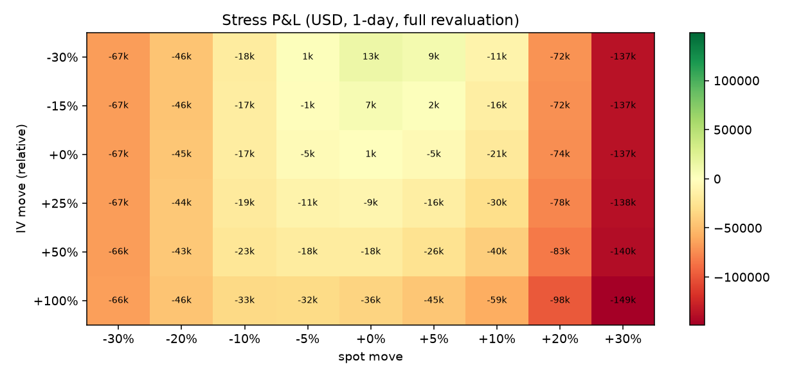
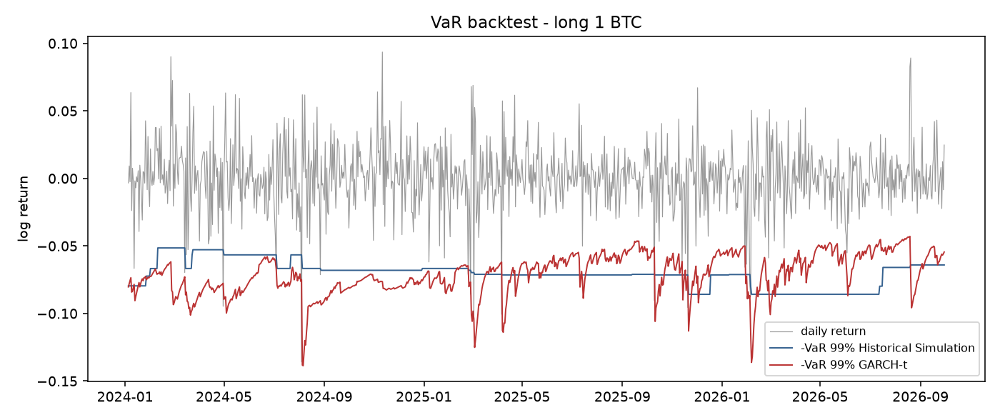
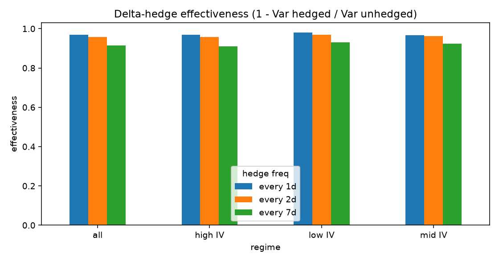

# BTC Options Portfolio Risk Engine

Prices a BTC options book on Deribit data (Black-76) and breaks its risk into Greeks.
Measures 1-day VaR and Expected Shortfall under competing model assumptions, stress-tests joint spot / implied-vol shocks, and fits GARCH-t vol dynamics.
Validates the VaR models with Kupiec and Christoffersen backtests and measures delta-hedge effectiveness across vol regimes.

## Headline findings (Deribit snapshot, 30 Sep 2026)

| # | Finding | Evidence |
|---|---|---|
| 1 | **Normal-tailed VaR fails; fat tails pass.** Normal and GARCH-Normal are rejected; GARCH-t is accepted. | 99% VaR, 1,000 days: **22** and **21** exceptions vs **10** expected (Kupiec p = 0.001 / 0.002); GARCH-t **11** exceptions, Kupiec p = **0.75** |
| 2 | **The worst stress is a melt-up, not a crash.** The long 25-delta put hedges only the downside; the short call is naked upside. | Spot +25% / IV +20%: **-106k USD** vs spot -30% / IV +50%: **-66k USD** |
| 3 | **Model risk is material.** VaR shifts by up to 23% under alternative smile / approximation assumptions. | Baseline 16,156 USD; sticky-moneyness **+20%**; delta-gamma-vega-theta approximation **+23%** |
| 4 | **Hedge frequency matters.** Daily delta hedging of a short 30-day ATM call beats weekly. | Hedge effectiveness **97%** daily vs **91%** weekly (491 windows) |

Full results: [docs/sample_report.md](docs/sample_report.md)

### Stress test: spot x implied-vol shocks


### VaR backtest: long 1 BTC, 99%, rolling 500-day window


### Delta-hedge effectiveness by vol regime and hedge frequency


## Reproduce
```bash
python -m venv .venv && .venv\Scripts\activate         # macOS/Linux: source .venv/bin/activate
pip install -r requirements.txt
python -m pytest -q                  # 12 tests: Greeks vs finite differences, parity, IV, GARCH, Kupiec, cache
python run.py --mode cache           # rebuilds docs/sample_report.md exactly from the saved 30 Sep 2026 snapshot (no network)
```
Other modes: `python run.py` (live Deribit public API, no key) and `python run.py --mode synthetic` (offline, labelled SYNTHETIC).

## Methods
| Question | Module | Method |
|---|---|---|
| Where does the risk come from? | `portfolio.py` | Black-76 Greeks per leg (cash gamma per 1%); quadratic smile per expiry |
| How much can it lose in a day? | `risk.py` | Historical full revaluation on joint spot + DVOL shocks; Monte Carlo (GARCH-t spot, regression-linked IV) |
| What happens in extreme markets? | `risk.py` | Spot x IV stress grid; named historical and hypothetical scenarios |
| How does vol behave? | `vol.py` | GARCH(1,1) Normal / Student-t by maximum likelihood, written from scratch |
| Do the risk models work? | `backtest.py` | Rolling 99% VaR backtest; Kupiec and Christoffersen tests |
| Does the hedge work, and when? | `backtest.py` | Short 30d ATM call delta-hedged daily / 2-day / weekly, split by IV regime |

## Limitations
r = 0, a parallel IV shock (no separate skew or term-structure factors), no transaction costs in the hedge study,
overlapping hedge windows, and a very heavy-tailed GARCH-t fit (nu = 2.99), so tail estimates are indicative.
Full list: [report section 7](docs/sample_report.md#7-assumptions-and-limitations).

Built with AI-assisted development; model design, validation and interpretation are my own.
