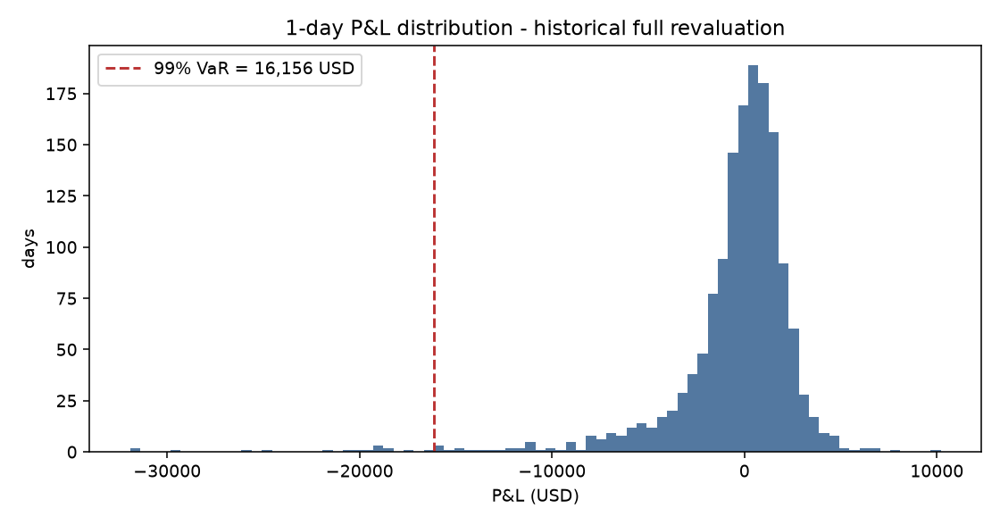
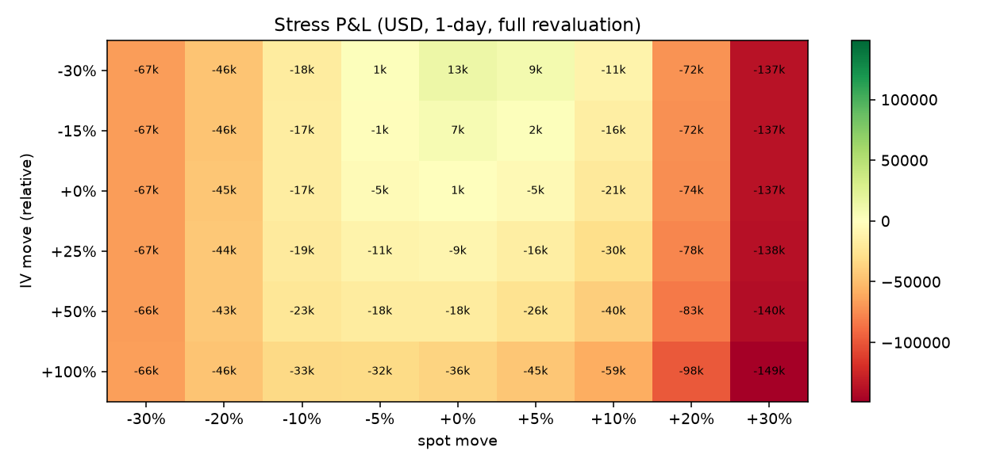
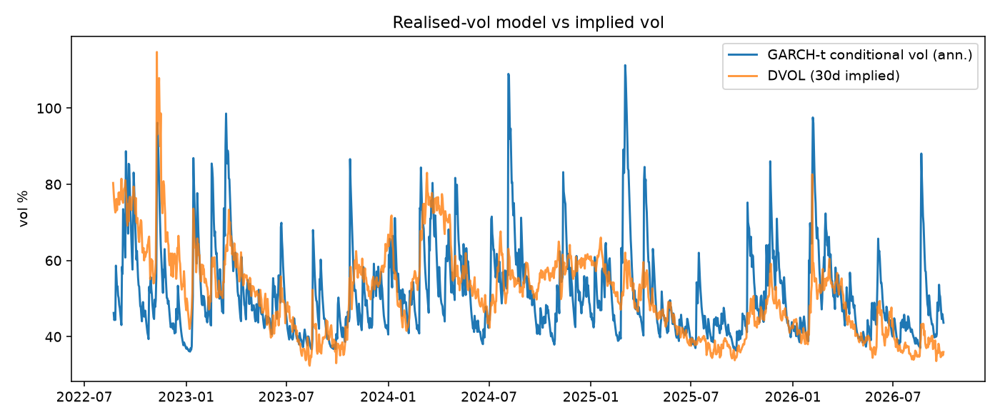
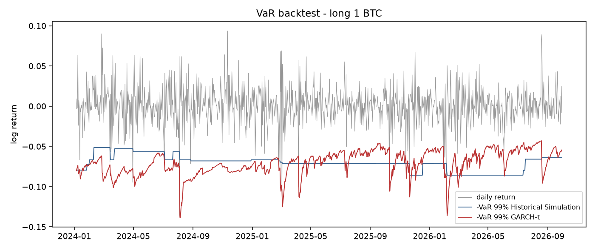
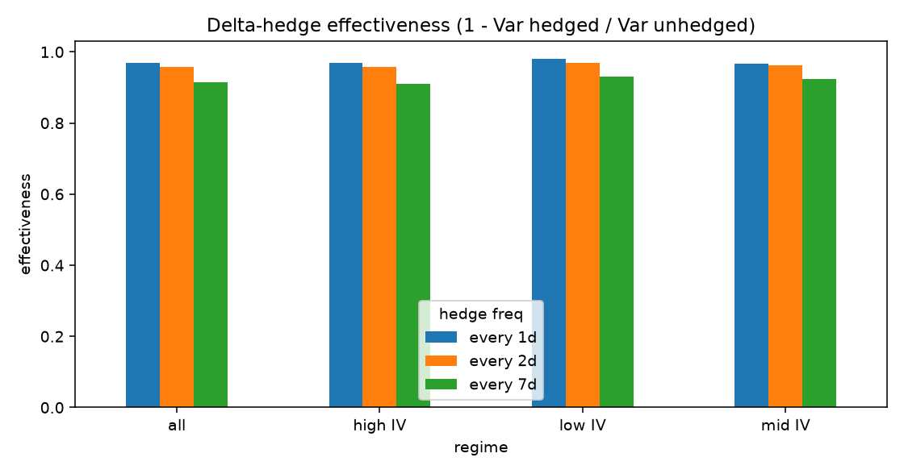

# BTC Options Portfolio - Risk Research Report

**Data source:** Deribit snapshot of 2026-09-30 13:07 UTC (cached)  
**History:** 2022-08-23 to 2026-09-30 (1500 daily joint spot/IV shocks)  
**Portfolio expiry:** 2026-10-30 (29.8 days) | forward F = 85,656 | ATM K = 86,000 | 25-delta put K = 80,000

## 1. Portfolio and sources of risk
Illustrative short-volatility book with a tail hedge: short ATM straddle, long 25-delta puts, delta flattened with the future. Greeks in USD (vega per vol point, theta per day).

| position             |       qty |   delta |   cash gamma (USD per 1% move) |   gamma P&L 1% (USD) |   vega |   theta |   value |
|:---------------------|----------:|--------:|-------------------------------:|---------------------:|-------:|--------:|--------:|
| Short ATM call       | -10       |  -5.034 |                        -34,671 |                 -173 |   -976 |     565 | -32,039 |
| Short ATM put        | -10       |   4.966 |                        -34,671 |                 -173 |   -976 |     565 | -35,482 |
| Long 25d put         |  10       |  -2.344 |                         25,926 |                  130 |    751 |    -447 |  12,524 |
| Delta hedge (future) |   2.41234 |   2.412 |                              0 |                    0 |      0 |       0 |       0 |
| TOTAL                |   0       |   0     |                        -43,416 |                 -217 | -1,201 |     683 | -54,996 |

Cash gamma = gamma x F^2 / 100, the change in USD delta for a 1% spot move; gamma P&L 1% = 0.5 x gamma x (0.01 x F)^2, the P&L from gamma alone for a 1% move in either direction.

Smile fit (iv = a + b k + c k^2, k = ln K/F): a = 0.364, b = -0.158, c = 1.218.

## 2. Value-at-Risk and Expected Shortfall (1-day)
| method                                                |   VaR 99% |   ES 97.5% |
|:------------------------------------------------------|----------:|-----------:|
| Historical sim - full reval, sticky strike            |    16,156 |     16,694 |
| Historical sim - full reval, sticky moneyness         |    19,384 |     19,463 |
| Historical sim - spot shocks only (no IV shocks)      |    13,524 |     14,186 |
| Historical sim - delta-gamma-vega-theta approximation |    19,928 |     19,740 |
| Monte Carlo - GARCH-t spot + regression IV shocks     |    12,117 |     17,204 |

**Reading the comparison:**
- Historical sim - full reval, sticky moneyness: VaR 19,384 USD (+20% vs baseline full-reval sticky-strike).
- Historical sim - spot shocks only (no IV shocks): VaR 13,524 USD (-16% vs baseline full-reval sticky-strike).
- Historical sim - delta-gamma-vega-theta approximation: VaR 19,928 USD (+23% vs baseline full-reval sticky-strike).
- Monte Carlo - GARCH-t spot + regression IV shocks: VaR 12,117 USD (-25% vs baseline full-reval sticky-strike).

## 3. Stress tests
| scenario                                    | spot move   | IV move (rel.)   |   P&L (USD) |
|:--------------------------------------------|:------------|:-----------------|------------:|
| Worst historical day in sample (2024-08-04) | -12.70%     | 9.10%            |     -24,894 |
| Best historical day in sample (2023-10-23)  | 11.46%      | 13.44%           |     -31,746 |
| Largest DVOL spike in sample (2026-02-05)   | -8.31%      | 54.52%           |     -21,500 |
| Hypothetical crash: spot -30%, IV +50%      | -30.00%     | 50.00%           |     -66,375 |
| Hypothetical melt-up: spot +25%, IV +20%    | 25.00%      | 20.00%           |    -106,336 |
| Hypothetical vol crush: spot 0%, IV -30%    | 0.00%       | -30.00%          |      13,484 |

## 4. Volatility dynamics - GARCH(1,1)-t
alpha = 0.133, beta = 0.822, persistence = 0.955, nu = 2.99 (fat tails if < ~10), long-run vol = 68.6% annualised. One-day-ahead forecast: 2.37% (45.3% annualised). Spot/IV dependency (OLS of relative IV change on log return): beta = -0.17.

## 5. Model validation - VaR backtest (long 1 BTC, 99%, rolling 500-day window)
| model                 |   days |   exceptions |   expected | rate   |   Kupiec p |   Christoffersen p | verdict   |
|:----------------------|-------:|-------------:|-----------:|:-------|-----------:|-------------------:|:----------|
| Historical Simulation |   1000 |           13 |         10 | 1.30%  |      0.362 |              0.157 | accept    |
| Normal                |   1000 |           22 |         10 | 2.20%  |      0.001 |              0.505 | reject    |
| GARCH-Normal          |   1000 |           21 |         10 | 2.10%  |      0.002 |              0.459 | reject    |
| GARCH-t               |   1000 |           11 |         10 | 1.10%  |      0.754 |              0.621 | accept    |

Kupiec tests whether the exception rate matches 1%; Christoffersen tests whether exceptions cluster. p < 0.05 rejects the model.

## 6. Hedge research - delta-hedging a short 30-day ATM call
| regime   | hedge freq   |   windows | effectiveness   | mean P&L (% spot)   | P&L stdev (% spot)   | 5% worst (% spot)   |
|:---------|:-------------|----------:|:----------------|:--------------------|:---------------------|:--------------------|
| all      | every 1d     |       491 | 96.83%          | 1.02%               | 1.98%                | -1.99%              |
| all      | every 2d     |       491 | 95.76%          | 1.00%               | 2.30%                | -2.63%              |
| all      | every 7d     |       491 | 91.38%          | 0.77%               | 3.27%                | -5.09%              |
| low IV   | every 1d     |       164 | 98.15%          | 0.48%               | 1.50%                | -1.96%              |
| low IV   | every 2d     |       164 | 96.96%          | 0.22%               | 1.92%                | -2.82%              |
| low IV   | every 7d     |       164 | 93.16%          | -0.42%              | 2.88%                | -6.25%              |
| mid IV   | every 1d     |       163 | 96.75%          | 0.49%               | 2.00%                | -2.88%              |
| mid IV   | every 2d     |       163 | 96.32%          | 0.54%               | 2.13%                | -3.36%              |
| mid IV   | every 7d     |       163 | 92.47%          | 0.51%               | 3.04%                | -4.64%              |
| high IV  | every 1d     |       164 | 96.88%          | 2.10%               | 1.97%                | -0.68%              |
| high IV  | every 2d     |       164 | 95.75%          | 2.25%               | 2.29%                | -1.68%              |
| high IV  | every 7d     |       164 | 91.08%          | 2.24%               | 3.32%                | -3.42%              |

- Best overall hedge frequency: every 1d (effectiveness 97%).
- Average implied minus realised vol at inception: +7.3% - the sign of the variance risk premium the short-vol seller is paid to carry.
- Daily hedging effectiveness: low IV 98%, high IV 97%. Weekly hedging: low IV 93%, high IV 91%. The cost of hedging less often is 5.5% of effectiveness overall.

## 7. Assumptions and limitations
- Black-76 with r = 0; no funding, basis or discounting effects.
- One smile per expiry (quadratic in log-moneyness); IV scenario shocks applied as a parallel relative shift equal to the same-day DVOL change - skew and term-structure moves are not modelled separately.
- Historical simulation assumes the sample contains the relevant tail; it is blind to regimes not in the window.
- Hedge study: daily closes, no transaction costs or slippage, constant implied vol over the option's life, overlapping windows (observations are autocorrelated, so effective sample size is smaller than the count).
- The fitted Student-t degrees of freedom (nu = 2.99) imply extremely heavy tails; variance is barely finite as nu approaches 2, so Expected Shortfall and Monte Carlo tail estimates are unstable and should be read as indicative.
- Illustrative portfolio, not a real trading position.

## 8. Next research steps
- Replace the parallel IV shock with PCA on the implied-vol surface (level / skew / curvature).
- Filtered historical simulation (GARCH-scaled residuals) to make HS VaR regime-aware.
- Add transaction costs and gamma-threshold (band) hedging to the hedge study.
- Tail modelling with Extreme Value Theory (peaks-over-threshold) for ES.